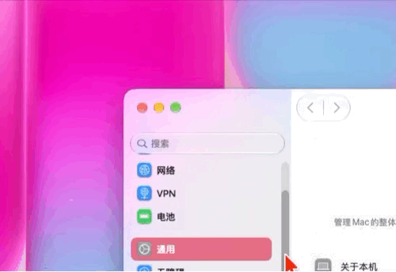

# Better Traffic Lights

[](https://www.apple.com/macos/)
[](LICENSE)

**Make the red, yellow, and green controls easier to see and use.** Better Traffic Lights is a small macOS menu bar app focused on one job: magnifying a window’s traffic-light controls when you move the pointer over them.

[English](#english) · [简体中文](#简体中文)

## English

### Requirements

- macOS 26 Tahoe or later.
- Apple Silicon or Intel Mac.

### Why we built this

macOS traffic lights are beautifully integrated into the title bar, but their small targets can be harder to hit with a mouse than the window controls many users are used to on Windows. As a result, many Mac users turn to keyboard shortcuts, even though pointing to a visible control is often the most intuitive way to act on a window.

We were inspired by [Apple’s new touch-enabled MacBook Pro](https://www.apple.com/newsroom/2026/10/apple-unveils-groundbreaking-macbook-pro-with-proled-xdr-display/), where [the traffic-light controls grow when touched](https://www.macrumors.com/2026/10/30/macbook-pro-proled-xdr-details/) to make them easier to choose. We wondered whether a similar, temporary enlargement could help mouse users on ordinary MacBooks and other Macs too. Better Traffic Lights is our attempt to bring that interaction to them.

### How this project came about

Better Traffic Lights grew out of [Traffic Lights+](https://github.com/Liu223344/traffic-light-plus). The upstream project supplied the starting point for a Swift macOS app, including its approach to finding native window controls through Accessibility and drawing an overlay. Thanks to Liu223344 and the contributors to the original project.

This edition narrows that starting point to the everyday task we wanted to keep: enlarging the three window controls and adjusting their spacing. We removed unrelated Dock and Stage Manager tools, made hover magnification work independently, and kept enlargement of the hovered button as an optional extra. The settings, app identity, control appearance, and Chinese/English copy were reshaped for this smaller scope. Window updates were also changed to respond to system and Accessibility events instead of repeatedly scanning every window, addressing the high CPU use observed during interaction.

This is a modified derivative of an open-source project. It is an independent community project and is not affiliated with the upstream author or Apple. See **Origin and license** below.

### What it does

- Smoothly enlarges the three traffic-light controls when the pointer enters their area, then collapses them when it leaves.
- Optionally enlarges only the button under the pointer one step further. This option requires hover magnification.
- Lets you adjust button size and spacing with a smooth, interactive Liquid Glass slider; the default button size is 18 pt.
- Preserves the native close, minimize, and zoom actions.
- Works with foreground and background windows, including supported fullscreen windows and multiple displays.
- Automatically follows the preferred language set in macOS: Simplified Chinese on a Chinese system, or English on an English system.
- Stores preferences locally and includes no ads, accounts, analytics, or telemetry.

Persistent display mode may leave visible trailing artifacts while you drag a window because of limitations in the overlay-based implementation. For the smoothest experience, turn off persistent display and use hover magnification instead; the controls enlarge only when the pointer moves over them.

### Preview

This animation shows the traffic lights at rest, enlarging when the pointer hovers over them, and returning to their normal size when the pointer moves away. The app follows the preferred language in macOS, showing Simplified Chinese when a Chinese language is preferred and English otherwise.

<p align="center"></p>

### Install and permissions

Get a package from [Releases](https://github.com/drfcy/Better-Traffic-Lights/releases) and move `Better Traffic Lights.app` to Applications. On first use, allow Better Traffic Lights under **System Settings > Privacy & Security > Accessibility**. The permission is used to locate standard window controls and invoke their corresponding window actions.

Public builds currently use ad-hoc signing and are not notarized by Apple. If macOS blocks the app on first launch, right-click it in Finder and choose **Open**.

### Build from source

Xcode Command Line Tools are required:

```sh
git clone https://github.com/drfcy/Better-Traffic-Lights.git
cd Better-Traffic-Lights
swift test
./scripts/build-app.sh
open "build/Better Traffic Lights.app"
```

The build script targets the current Mac by default. Set `TARGET_ARCH=arm64` or `TARGET_ARCH=x86_64` to choose an architecture. DMG and ZIP packaging scripts are in `scripts/`.

### Implementation and limits

macOS does not expose a public API for resizing another app’s native traffic-light controls. Better Traffic Lights uses Accessibility to find standard controls, draws enlarged versions in separate non-activating panels, and invokes the native actions. Apps with custom title bars or without standard Accessibility controls may not work. The overlay also cannot become part of the target app’s own window composition.

### Origin and license

This repository is modified from [Liu223344/traffic-light-plus](https://github.com/Liu223344/traffic-light-plus) and is distributed under the MIT License. See [LICENSE](LICENSE). When redistributing this project or substantial portions of it, retain the copyright and permission notices in that license. Better Traffic Lights is maintained independently; its current features and changes are described in this repository.

## 简体中文

### 系统要求

- macOS 26 Tahoe 或更高版本。
- Apple Silicon 或 Intel Mac。

### 为什么做这个软件

macOS 原生红绿灯外观精致，也与标题栏融为一体，但按钮比许多用户熟悉的 Windows 窗口控制按钮小，鼠标不容易准确点中。因此，不少 Mac 用户逐渐习惯使用快捷键；但对着看得见的窗口按钮直接点击，往往更符合直觉。

我们的灵感来自[苹果新推出的支持触控的 MacBook Pro](https://www.apple.com/newsroom/2026/10/apple-unveils-groundbreaking-macbook-pro-with-proled-xdr-display/)：触控时，[窗口红绿灯会放大一圈](https://www.macrumors.com/2026/10/30/macbook-pro-proled-xdr-details/)，方便用户选择。我们由此想到，能否把这种即时放大的反馈也带到普通 MacBook 和其他 Mac 上，让鼠标用户同样更容易点中窗口按钮？Better Traffic Lights 就是对这个问题的一次尝试。

### 这个项目是怎么来的

Better Traffic Lights 是从 [Traffic Lights+](https://github.com/Liu223344/traffic-light-plus) 改造而来的。原项目提供了 Swift/macOS 应用基础，以及通过辅助功能定位窗口按钮、绘制悬浮覆盖层的实现起点。感谢原作者 Liu223344 和原项目贡献者。

我们在这个基础上，围绕日常使用中的核心需求重新收窄了产品范围：保留红绿灯放大和按钮间距调整，移除了 Dock、台前调度等旁支功能；把悬停放大作为独立功能，并让“单个按钮额外放大”成为它的可选增强；重新整理了设置界面、按钮外观、应用图标和中英文文案。为降低使用时的 CPU 负载，窗口状态更新也调整为依赖系统与辅助功能事件，避免周期性全量扫描。

这是一个基于上游开源项目持续修改的衍生版本，并非与上游作者或 Apple 官方关联的产品。上游项目和许可证信息见下方“来源与许可证”。

### 当前功能

- 鼠标移到窗口左上角红绿灯区域时，三个按钮平滑放大；离开后收起。
- 可选开启“单个按钮额外放大”，悬停的按钮会再放大一档。该选项依赖悬停放大。
- 可通过顺滑的液态玻璃滑块调整按钮大小与间距，默认按钮大小为 18 pt。
- 红、黄、绿按钮仍执行 macOS 原有的关闭、最小化和缩放操作。
- 前台和后台窗口都可触发；支持标准辅助功能按钮的全屏窗口及多显示器场景。
- 设置界面自动跟随 macOS 系统语言：系统首选语言为中文时显示简体中文，为英文时显示英文。
- 设置保存在本机。应用不包含广告、账号、分析统计或遥测。

受覆盖层实现方式的限制，开启常驻模式时，拖动窗口可能会看到红绿灯跟随时留下的拖影。建议关闭常驻模式，改用悬停放大：只有鼠标移到红绿灯区域时，按钮才会放大。

### 预览

这段动画展示了红绿灯的原生状态、鼠标悬停时的平滑放大，以及鼠标移开后的收回效果。应用会跟随 macOS 的首选语言：中文首选语言显示简体中文，其他语言默认显示英文。

<p align="center"></p>

### 安装与权限

从 [Releases](https://github.com/drfcy/Better-Traffic-Lights/releases) 获取发布包，将 `Better Traffic Lights.app` 拖到“应用程序”文件夹。首次使用时，在“系统设置 > 隐私与安全性 > 辅助功能”中允许 Better Traffic Lights。该权限用于读取标准窗口按钮的位置并执行对应的窗口操作。

公开构建目前使用 ad-hoc 签名，尚未经过 Apple 公证。首次启动若被 macOS 拦截，可在 Finder 中右键应用并选择“打开”。

### 从源码构建

需要 Xcode Command Line Tools：

```sh
git clone https://github.com/drfcy/Better-Traffic-Lights.git
cd Better-Traffic-Lights
swift test
./scripts/build-app.sh
open "build/Better Traffic Lights.app"
```

默认构建当前 Mac 的架构；可通过 `TARGET_ARCH=arm64` 或 `TARGET_ARCH=x86_64` 指定目标架构。DMG 和 ZIP 打包脚本位于 `scripts/`。

### 实现与限制

macOS 没有公开 API 可直接调整其他应用的原生红绿灯尺寸。Better Traffic Lights 使用辅助功能 API 发现标准窗口按钮，并通过独立的非激活面板绘制放大后的按钮，同时调用原生按钮操作。自行绘制标题栏或不公开标准辅助功能按钮的应用可能无法使用；覆盖层也无法成为目标应用窗口合成树的一部分。

### 来源与许可证

本项目基于 [Liu223344/traffic-light-plus](https://github.com/Liu223344/traffic-light-plus) 修改，并依照 MIT License 发布。请参阅 [LICENSE](LICENSE)；再分发本项目或其重要部分时，应保留许可证中的版权和许可声明。Better Traffic Lights 与上游项目保持独立发布，功能和后续改动以本仓库为准。
